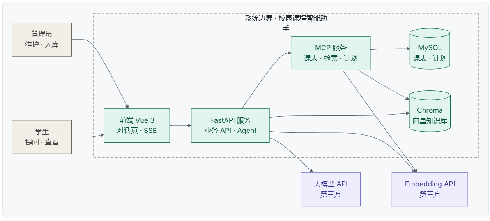
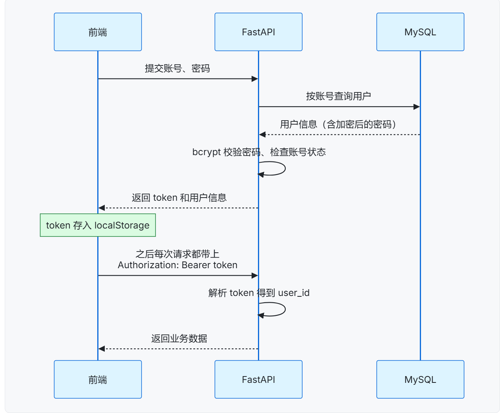
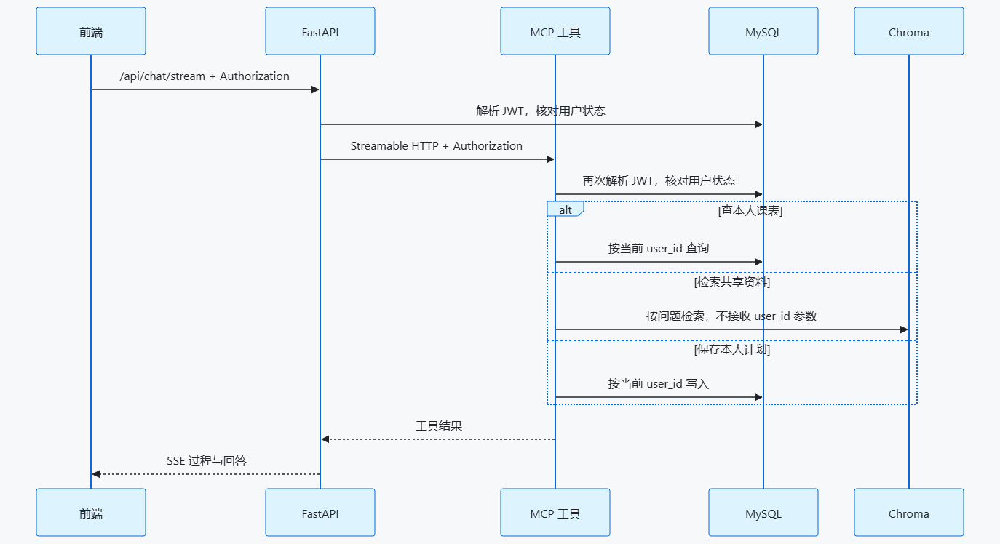
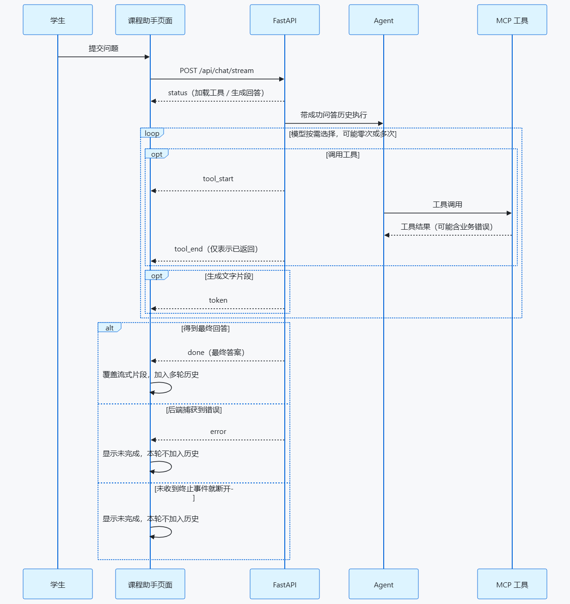
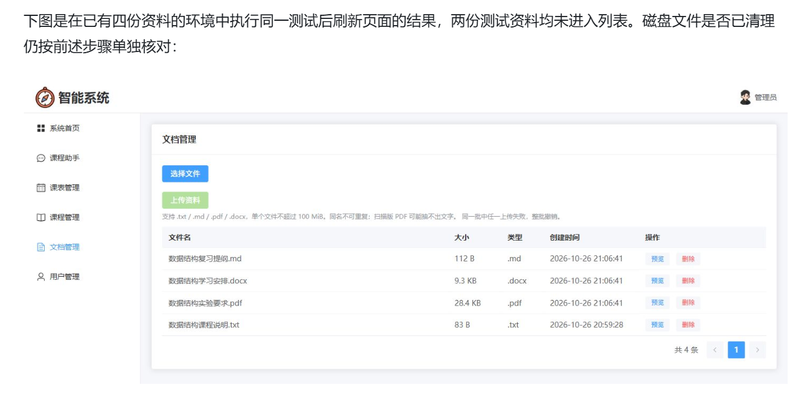

# 使用文档 · 校园课程智能助手

本文按「看图理解 → 分模块操作 → 调试与排错」组织，参考文档中的 **14 张配图全部收录在 `docs/images/`**，下面逐张说明其对应的实现位置与核对要点，避免遗漏。

---

## 一、配图索引（14 张，逐张对应）

| 图 | 文件 | 内容 | 对应实现 |
| --- | --- | --- | --- |
| 1 | [`image1.png`](images/image1.png) | 系统组件与数据去向：四进程、MySQL / Chroma / 模型与 Embedding 第三方 | `frontend/src/api/chat.js`、`backend/app/api/chat.py`、`backend/mcp_server.py` |
| 2 | [`image2.png`](images/image2.png) | 成品演示流程：admin 入库 → aaa 登录 → 查课表 → 问资料 → 存计划 → 换 bbb 验证隔离 | `README.md` 第 9 节冒烟验证 |
| 3 | [`image3.png`](images/image3.png) | 学生侧三项能力：只读课表、手动/助手生成计划、助手检索知识库 | `Schedule.vue`、`StudyPlan.vue`、`Chat.vue` |
| 4 | [`image4.png`](images/image4.png) | MCP 三个工具：JWT 解析 `user_id`，工具不接收身份参数 | `backend/mcp_server.py` |
| 5 | [`image5.png`](images/image5.png) | ReAct 循环：模型推理 → 是否调用工具 → 工具结果回模型 → SSE 逐字推送 | `backend/app/services/agent_service.py` |
| 6 | [`image6.png`](images/image6.png) | RAG 写入（上传时）与读取（提问时）两条路径 | `backend/app/services/rag_service.py` |
| 7 | [`image7.png`](images/image7.png) | 一次对话链路 + 管理员文档入库链路 | `agent_service.py` / `document_service.py` |
| 8 | [`image8.png`](images/image8.png) | 登录时序：bcrypt 校验、签发 JWT、localStorage、每次请求带 Bearer | `auth_service.py`、`utils/jwt.py`、`utils/auth.js` |
| 9 | [`image9.png`](images/image9.png) | MCP Inspector：Server ID / Transport / URL / Auth token | `README.md` 第 5 节 |
| 10 | [`image10.png`](images/image10.png) | Swagger Authorize：OAuth2 password 流，Token URL `/api/auth/token` | `backend/app/api/auth.py`、`dependencies/auth.py` |
| 11 | [`image11.png`](images/image11.png) | LangGraph Agent 执行时序：create_agent / DeepSeek / 工具节点 / MCP Client 转发 JWT | `agent_service.py`、`mcp_client_service.py` |
| 12 | [`image12.png`](images/image12.png) | 文档管理页面：菜单顺序、表格列、按钮、提示文案、分页「共 N 条」、整批回滚 | `frontend/src/views/Documents.vue` |
| 13 | [`image13.png`](images/image13.png) | JWT 双层校验时序：FastAPI 验一次，MCP 工具再验一次；共享检索不接收 `user_id` | `dependencies/auth.py`、`dependencies/mcp_auth.py` |
| 14 | [`image14.png`](images/image14.png) | SSE 事件与前端状态：`status`/`tool_start`/`tool_end`/`token`/`done`/`error`，断连按未完成 | `api/chat.js`、`views/Chat.vue` |

### 关键图示

**系统组件（图 1）**



**登录时序（图 8）**



**JWT 双层校验（图 13）**



**SSE 事件边界（图 14）**



**文档管理页面（图 12）**



---

## 二、角色与菜单

| 角色 | 可见菜单（顺序与图 12 一致） |
| --- | --- |
| 学生 `student` | 系统首页、课程助手、我的课表、学习计划 |
| 管理员 `admin` | 系统首页、课程助手、课表管理、课程管理、文档管理、用户管理 |

菜单隐藏 ≠ 权限控制：所有管理接口都挂 `get_current_admin`，学生直接调用会得到 `code=403`；未登录为 HTTP 401。

## 三、管理员操作

### 3.1 课程管理

`/manager/course`：新增 / 编辑 / 删除 / 模糊查询。课程代码必填且唯一；**已关联课表的课程不可删除**。演示数据已包含 `ENG101` / `DS101` / `MATH101` 三门课。

### 3.2 课表管理

`/manager/schedule-manage`：按学生、日期筛选，新增 / 编辑 / 删除，分页显示 `{ list, total }`。只能给 `student` 角色排课；课程下拉只显示「正常」状态的课程。

学生端 `/manager/schedule` 共用同一个分页接口，但后端**忽略**请求中的 `user_id`，固定查当前 JWT 用户，因此 `bbb` 看不到 `aaa` 的课表。

### 3.3 文档管理（图 12）

`/manager/documents`：

1. 点「选择文件」可多选 `.txt` / `.md` / `.pdf` / `.docx`（单个 ≤ 100 MiB，同名不可重复）。
2. 点「上传并入库」把整批文件用同一个 `files` 字段提交。后端依次：保存原文件到 `backend/data/kb` → 抽取纯文本 → 500/50 分块 → Embedding → 写入 Chroma（片段带 `doc_id` / `source` / `scope=kb`）。
3. **同一批中任一文件失败，整批撤销**：数据库记录、本批磁盘文件、本批向量片段都会清理，历史资料不受影响（图 12 演示的就是两份测试资料均未进入列表）。
4. 「预览」用文本插值显示抽取出的纯文本，Markdown 标记按原样显示；重复打开预览时用请求编号防止旧请求覆盖新结果。
5. 「重新入库」先按 `doc_id` 删旧片段再重写，重复点击不会累积重复片段。
6. 「删除」先清理向量、再删记录、最后删原文件；确认框会提示会影响后续检索。

> 扫描版 PDF 没有文字层，可能上传成功但无法抽取文本；预览或入库失败时删除记录后用修复过的同名文件重新上传。

### 3.4 用户管理

沿用脚手架：新增用户时可指定 `admin` / `student` 角色；自行注册的账号固定为 `student`。

## 四、学生操作

### 4.1 我的课表

只读列表，支持按日期筛选与分页。数据与助手「查询我的课表」的结果完全一致（两者最终都走 `schedule_service.list_schedules`）。

### 4.2 学习计划

上方文本框手动保存（上限 2000 字，后端同样校验），下方按 id 倒序分页展示。「查看」用 `marked` + `DOMPurify` 安全渲染 Markdown。删除按 `id + user_id` 定位，不能删别人的计划。

### 4.3 课程助手

页面开场文案已按最终版本统一：

> 你好，我是校园课程助手。你可以查询自己的课表、提问课程资料，也可以让我制定学习计划；确认后说"保存"，我才会写入学习计划。

| 工具名 | 过程区显示 |
| --- | --- |
| `get_my_schedules` | 查询我的课表 |
| `search_course_docs` | 检索课程资料 |
| `save_study_plan` | 保存学习计划 |

**事件与状态（图 14）**：

| 事件 | 页面行为 |
| --- | --- |
| `status` | 追加「正在加载课程工具 / 正在生成回答」 |
| `tool_start` / `tool_end` | 追加「开始：…」/「已返回：…」；已返回**不等于**业务成功 |
| `token` | 逐段追加到回答气泡 |
| `done` | 用 `answer` 覆盖流式片段；本轮问答加入下一次追问的 `history` |
| `error` | 显示未完成、回填问题、本轮**不加入**历史 |
| 未收到终止事件就断开 | 与 `error` 相同处理 |

- 前端只把成功的问答文字放进 `history`，不含过程区内容；服务端不保存会话，刷新页面即清空。
- 只输入空格不会发请求。
- 回答里的 Markdown 表格、列表会正常渲染，用户提问始终按普通文本显示。
- 模型不能查询他人课表；知识库对所有已登录学生共享，但工具不接受 `user_id` 参数（图 13）。
- 资料检索 `error`（服务不可用）与 `items=[]`（检索成功但无片段）在提示词中被严格区分，禁止编造资料里没有的规定。

## 五、调试通道

### 5.1 Swagger（图 10）

`http://127.0.0.1:8000/docs` → **Authorize** → 填 `admin/admin` 或 `aaa/123`，`client_id` / `client_secret` 留空 → 之后可调用所有带锁接口。`POST /api/auth/token` 只给 Swagger 用，前端仍走 `POST /api/auth/login`。

`POST /api/chat/ask` 适合核对 `data.answer` 与 `data.tools_used`；`GET /api/mcp/my-schedule` 是不经过大模型的 MCP 调试通道，用于对比 REST 与工具两条路径结果是否一致。

### 5.2 MCP Inspector（图 9）

```powershell
npx @modelcontextprotocol/inspector
```

- Server ID：`campus-course-agent`
- Transport：`streamable-http`
- URL：`http://127.0.0.1:8001/mcp`
- 自定义 Headers：`{ "Authorization": "Bearer <学生 token>" }`

调试 `save_study_plan` 时再加 32 位小写十六进制的 `X-Chat-Turn-Id`；用同一个 ID 连续调用两次，第一次 `ok=true`，第二次提示「本轮已保存学习计划，请勿重复保存」。移除 `Authorization` 或轮次 ID 会分别得到鉴权 / 轮次错误，且不会写库。

### 5.3 核对向量片段

```powershell
cd backend
.\.venv\Scripts\Activate.ps1
@'
from langchain_chroma import Chroma
from app.config import settings
store = Chroma(collection_name=settings.CHROMA_COLLECTION,
               host=settings.CHROMA_HOST, port=settings.CHROMA_PORT)
result = store.get(where={"doc_id": "1"}, include=["documents", "metadatas"])
print("片段数：", len(result["ids"]))
'@ | python -
```

把 `1` 换成页面中的实际文档 ID。只读命令不会调用 Embedding API，也不会修改向量库。

## 六、故障边界速查

| 现象 | 期望表现 |
| --- | --- |
| 未登录调用 `/api/chat/stream` 或业务接口 | HTTP 401 |
| `question=""` | HTTP 422（页面空白输入由前端先拦截） |
| 历史中出现 `role="system"` / `"tool"` | HTTP 422 |
| 停掉 MCP 后提问 | SSE `error`：加载课程工具失败；不解释为「没有课程」 |
| 停掉 Chroma 后问资料 | 工具返回 `error`，回答说明检索不可用，不说「资料里没有」 |
| 清空 `LLM_API_KEY` 后提问 | 提示未配置密钥 |
| 图执行步数超限 | 提示缩小问题范围 |
| 模型回答「已保存」但页面无记录 | 以学习计划页与 `done` 事件为准，模型文字不能证明写库成功 |

业务异常统一是 **HTTP 200 + body 里非 200 的 `code`**，Swagger 显示 200 不代表成功，务必看 `code` 和 `message`。

## 七、扩展指引

1. 新增业务表：`models/` → `schemas/` → `services/` → `api/` → 前端 `api/` + `views/` → 路由与菜单；新模型加入 `app/models/__init__.py` 的 `__all__`。
2. 新增 MCP 工具：在 `backend/mcp_server.py` 用 `@mcp.tool()` 声明，参数只放业务字段，身份从 `_current_user_id()` 取；改完重启 MCP，Agent 每轮会自动拉到新工具。
3. 调整 Agent 行为：改 `agent_service.py` 的 `SYSTEM_PROMPT`；工具能力描述放在 MCP 工具的 docstring 与 `Field(description=...)` 中（普通注释不会进入工具定义）。
4. 更换 Embedding 模型：暂停上传与检索 → 换 `CHROMA_COLLECTION` → 重启 FastAPI / MCP → 全部资料重新入库；不要只凭旧的「已入库」标记判断新集合已有数据。
5. 生产化建议：把 MCP Client 提到模块级复用；为 SSE 增加超时与停止按钮；用 pgvector / Milvus 替代单机 Chroma；为 `data/kb` 与 `data/chroma` 配置备份。
